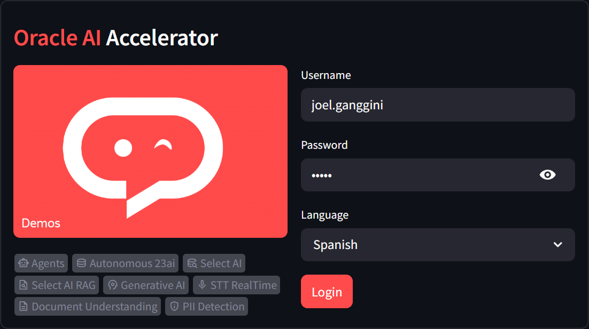

  

# Oracle AI Accelerator

Oracle AI Accelerator es una aplicación de laboratorio para equipos que quieren probar cómo procesar documentos, imágenes, audio y texto con Oracle Cloud Infrastructure (OCI). Desde Streamlit se pueden transcribir conversaciones, extraer texto de documentos y consultar información con agentes y búsqueda semántica.

## Inicio rápido

Necesitas una cuenta de OCI, acceso a Deploy Studio y un perfil OCI con clave de API y permisos en el compartimento de prueba.

1. En Deploy Studio elige **Oracle AI Accelerator** y un release publicado compatible con el manifiesto v2.
2. Carga **OCI config** y **API private key**. La región se toma del perfil. Selecciona un compartimento nuevo o existente y completa las tres contraseñas del formulario.
3. Pulsa **Validate**. Cuando termine, selecciona **Deploy** para iniciar el plan y, si pasa, la creación automática de los recursos. Sigue el resultado en Deploy Studio.
4. Abre la URL HTTPS del despliegue e inicia sesión como `admin` con el valor que ingresaste en **Application password**.

[Guía de despliegue con Deploy Studio](docs/4-automated-deployment-on-oci-resource-manager-linux.md) · [Releases de GitHub](https://github.com/jgangini/oracle-ai-accelerator/releases)

## Cómo funciona

| Componente | Función |
| --- | --- |
| Streamlit | Presenta los módulos de documentos, voz, agentes y consultas. |
| OCI Generative AI, Document Understanding y Speech | Procesan texto, documentos y audio según el módulo. |
| Autonomous AI Database 26ai | Guarda usuarios, permisos, archivos y fragmentos. Usa vectores para recuperar contenido por similitud y Select AI para consultas asistidas. |
| OCI Resource Manager, Compute y Object Storage | Aprovisionan la infraestructura. La VM aloja la aplicación y obtiene el wallet desde un bucket privado durante el arranque. |

[Modelo de datos](docs/5-data-model-documentation.md) · [Archivos SQL del esquema](setup/autonomous_database) · [Aplicación Streamlit](app/app.py)

## Documentación

- [Activar una cuenta de Oracle Cloud](docs/1-create-and-activate-an-oracle-cloud-account.md)
- [Preparar servicios y permisos OCI](docs/2-creating-and-preparing-services-for-the-project.md)
- [Ejecutar la aplicación en Windows](docs/3-instance-or-local-machine-configuration-windows.md)
- [Contrato, infraestructura y validación de Terraform](terraform/README.md)
- [Reportar un problema](https://github.com/jgangini/oracle-ai-accelerator/issues) y [ver las demos](https://youtube.com/playlist?list=PLMUWTQHw13gbqqVHaCid3gUBIlvfVKaBu)

## Créditos y licencia

Joel Gangini Garcia es el autor del proyecto. OpenAI Codex asistió en la actualización de la documentación y del contrato de despliegue. El código se distribuye bajo la [licencia MIT](LICENSE).
