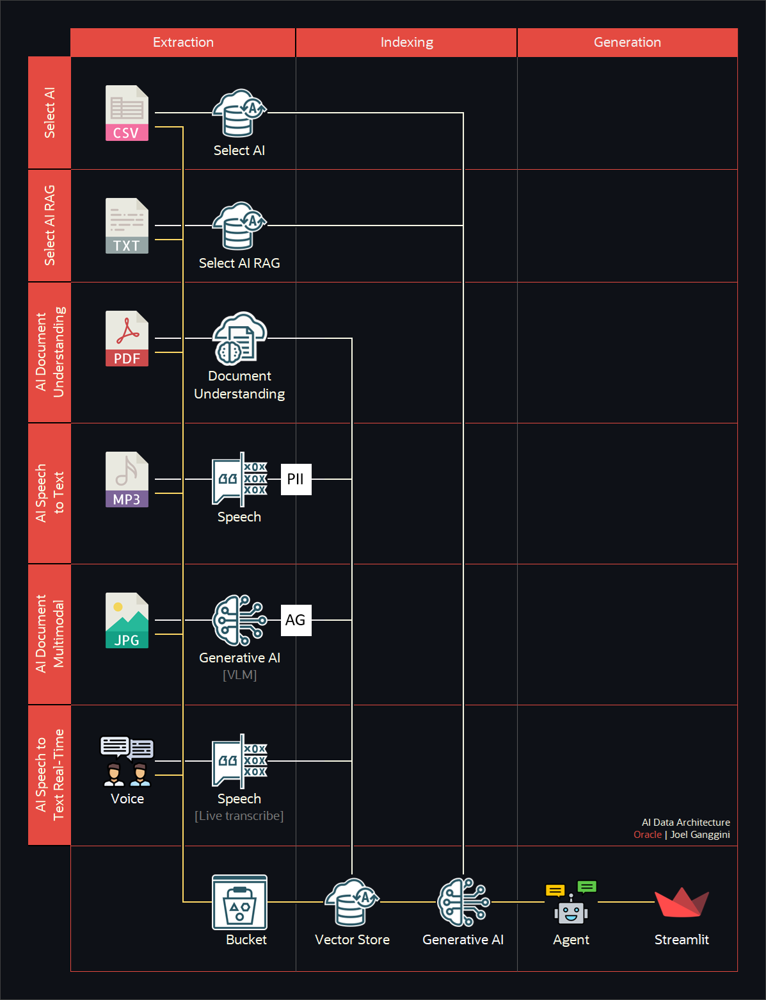

  

<h3 align="center">Oracle AI Accelerator</h3>

Laboratorio desplegable en OCI para extraer texto de documentos, transcribir audio y consultar datos desde Streamlit.

  
  
  

  
  
  

  <a href="#inicio-rápido">Inicio rápido</a> ·
  <a href="docs/deployment.md">Despliegue</a> ·
  <a href="docs/architecture.md">Arquitectura</a> ·
  <a href="docs/tutorial.md">Tutorial</a> ·
  <a href="docs/testing.md">Pruebas</a>

## Inicio rápido

Necesitas acceso a [Deploy Studio](https://cloudtechnext.net/#deploy), un perfil OCI con clave de API y permisos en el compartimento de prueba. La región del perfil debe ofrecer OCI Generative AI.

1. Selecciona **Oracle AI Accelerator** y un [release publicado](https://github.com/jgangini/oracle-ai-accelerator/releases).
2. Carga **OCI config** y **API private key**. Selecciona el compartimento y completa las tres contraseñas del formulario.
3. Pulsa **Validate** y luego **Deploy**. Espera a que el trabajo quede en **Succeeded**.
4. Abre **Application URL** e inicia sesión como `admin` con la contraseña **Application password**. Para comprobar el flujo de documentos, sigue el [tutorial con el PDF de ejemplo](docs/tutorial.md).

La [guía de despliegue](docs/deployment.md) detalla las credenciales, los recursos que se crean y dónde revisar una ejecución detenida.

## Qué puedes probar

| Entrada | Resultado en el laboratorio |
| --- | --- |
| PDF e imágenes de documentos | Texto extraído, PDF con texto buscable y resultados del análisis. |
| Audio y voz | Transcripciones mediante OCI Speech. |
| CSV y texto | Consultas con Select AI y respuestas basadas en texto recuperado por similitud. |

Lee el diagrama por filas. Cada fila muestra qué servicio recibe un tipo de entrada, cómo se procesa y qué resultado llega a Streamlit. La [arquitectura de despliegue](docs/architecture.md) describe por separado la VM, Autonomous AI Database y el bucket privado.

## Documentación

- [Desplegar y verificar el acceso](docs/deployment.md).
- [Arquitectura y modelo de datos](docs/architecture.md).
- [Extraer texto del primer PDF](docs/tutorial.md).
- [Ejecutar las pruebas de contrato y Terraform](docs/testing.md).
- [Contrato y configuración de Terraform](terraform/README.md).
- [Demos](https://youtube.com/playlist?list=PLMUWTQHw13gbqqVHaCid3gUBIlvfVKaBu) · [Reportar un problema](https://github.com/jgangini/oracle-ai-accelerator/issues).

## Autoría y licencia

Proyecto de Joel Gangini Garcia. [Licencia MIT](LICENSE).
