# Modelo de datos

Autonomous AI Database conserva la configuración de la aplicación, las asignaciones de acceso y los datos utilizados por los módulos. Las definiciones SQL son la referencia para columnas, restricciones e índices. [SQL del esquema](../setup/autonomous_database/developer)

El diagrama reúne las tablas de usuarios, agentes y archivos. La tabla siguiente incluye también las evaluaciones que carga el instalador.

| Área | Tablas | Qué relacionan |
| --- | --- | --- |
| Usuarios y módulos | `USER_GROUP`, `USERS`, `MODULES` | Cada usuario referencia un grupo. `USERS.USER_MODULES` guarda las asignaciones de módulos en un documento JSON. |
| Agentes | `AGENT_MODELS`, `AGENTS`, `AGENT_USER` | Cada agente puede referenciar un modelo. `AGENT_USER` relaciona usuarios y agentes y registra si el usuario es propietario. |
| Archivos | `FILES`, `FILE_USER` | `FILE_USER` relaciona archivos con usuarios y registra la propiedad. |
| Búsqueda semántica | `DOCS` | Cada fragmento referencia un archivo. La columna `EMBEDDING` es de tipo `VECTOR` y tiene un [índice vectorial](../setup/autonomous_database/developer/j.TABLE_DOCS.sql). |
| Evaluaciones | `QUIZ`, `QUIZ_ANSWERS` | Una evaluación referencia un archivo y un módulo. Cada respuesta referencia una evaluación y un usuario. |

La inicialización crea un grupo y un usuario administrativo para el laboratorio. En el despliegue automatizado, ese usuario recibe la contraseña de aplicación suministrada en el formulario. [Guía de despliegue](4-automated-deployment-on-oci-resource-manager-linux.md) · [Inicialización de usuarios](../setup/autonomous_database/developer/c.TABLE_USERS.sql)
