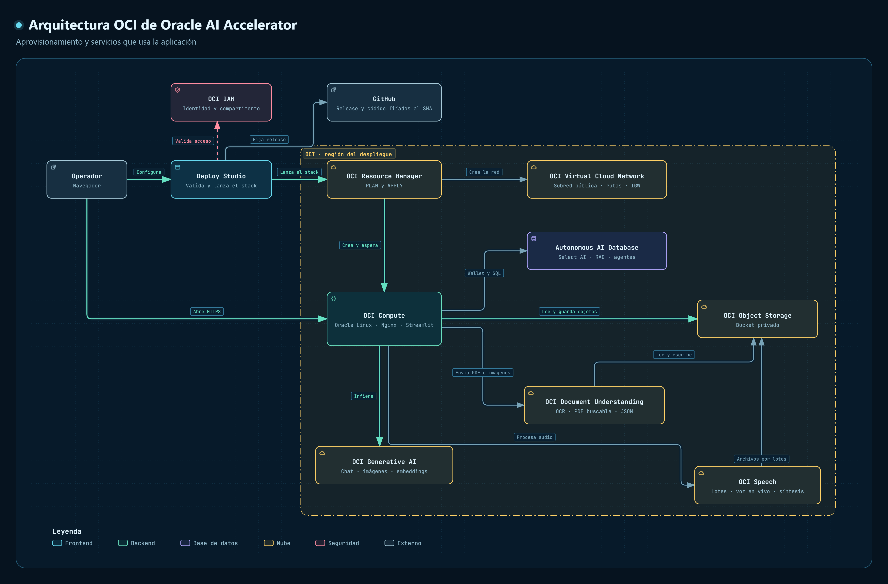

# Arquitectura de Oracle AI Accelerator

Oracle AI Accelerator instala Streamlit en una VM de OCI. El navegador usa Nginx para acceder a la aplicación. Autonomous AI Database conserva los registros del laboratorio y Object Storage guarda los archivos de entrada y salida.

El flujo superior muestra quién aprovisiona el entorno. Las conexiones desde la VM muestran cómo se usan los datos después del arranque.

## Despliegue

1. Deploy Studio valida el perfil OCI y fija el release de GitHub a su SHA. Resource Manager ejecuta el plan y después aplica ese plan.
2. Terraform crea la red, la VM, Autonomous AI Database y un bucket privado. La VM verifica el SHA, descarga el wallet directamente desde la base y ejecuta el script de inicialización de la aplicación.
3. Terraform espera la marca que la VM escribe tras verificar Streamlit a través de Nginx. Deploy Studio muestra la URL de la aplicación cuando termina el trabajo.

[Guía de despliegue](deployment.md) · [Manifiesto](../terraform/deploy-studio.json) · [Inicialización de la VM](../terraform/templatefile/user_data.sh)

## Servicios y recursos

| Servicio | Responsabilidad |
| --- | --- |
| GitHub | Publica el release y el código que la VM descarga y verifica al arrancar. |
| OCI IAM y OCI Resource Manager | Deploy Studio usa la identidad OCI para acceder al compartimento. Resource Manager ejecuta PLAN y APPLY. |
| OCI Networking | VCN con subred pública, Internet Gateway, lista de seguridad y tabla de rutas. |
| OCI Compute | VM Oracle Linux con Nginx y los procesos Streamlit. |
| Autonomous AI Database | Wallet, esquema del laboratorio, Vector Search, Select AI, Select AI RAG y agentes en la base de datos. |
| OCI Object Storage | Bucket privado para originales y salidas de procesamiento. |
| OCI Document Understanding | Lee los documentos del bucket y devuelve el PDF buscable y el JSON de análisis. |
| OCI Speech | Transcribe archivos por lotes, reconoce voz en tiempo real y sintetiza audio. |
| OCI Generative AI | Chat, análisis de imágenes y embeddings. Autonomous AI Database también usa modelos OCI en perfiles Select AI e indexación. |

La instalación usa repositorios de paquetes de Oracle Linux y Python. Las funciones de voz por WebRTC usan Google STUN. Cuando está habilitado el correo de acceso, Deploy Studio lo envía mediante Resend.

## Flujo de documentos

1. Streamlit recibe el PDF y guarda el original en el bucket privado.
2. Streamlit envía el trabajo a OCI Document Understanding. El servicio lee el original y guarda el PDF buscable y el JSON de análisis en Object Storage.
3. La aplicación extrae el texto por página, registra los datos del documento y conserva los fragmentos indexados en Autonomous AI Database. La pantalla **View** muestra las páginas, el archivo de salida y el texto extraído.

La [figura de los módulos](../img/architecture.png) muestra las rutas adicionales de CSV, texto, imágenes y audio. [Procesamiento de documentos](../app/services/oci_document_understanding.py) · [Tutorial con un PDF](tutorial.md)

## Modelo de datos

| Tabla o relación | Qué representa |
| --- | --- |
| [`users`](../setup/autonomous_database/developer/c.TABLE_USERS.sql) y [`user_group`](../setup/autonomous_database/developer/b.TABLE_USER_GROUP.sql) | Usuarios del laboratorio y su grupo. |
| [`modules`](../setup/autonomous_database/developer/d.TABLE_MODULES.sql) | Módulos ofrecidos en la interfaz y formatos admitidos. |
| [`files`](../setup/autonomous_database/developer/h.TABLE_FILES.sql) y [`file_user`](../setup/autonomous_database/developer/i.TABLE_FILE_USER.sql) | Metadatos de cada archivo y asociación con los usuarios que lo comparten. |
| [`docs`](../setup/autonomous_database/developer/j.TABLE_DOCS.sql) | Fragmentos indexados que apuntan al archivo de origen. |
| [`agents`](../setup/autonomous_database/developer/f.TABLE_AGENTS.sql) y [`agent_user`](../setup/autonomous_database/developer/g.TABLE_AGENT_USER.sql) | Definiciones de agentes y asociaciones con usuarios. |

Los binarios permanecen en Object Storage. El registro de archivo conserva su ruta y los datos de procesamiento. [Esquema SQL completo](../setup/autonomous_database)

## Límites del laboratorio

La VM tiene IP pública y un certificado inicial autofirmado. Las reglas de entrada del ejemplo deben revisarse antes de extender el acceso a otros usuarios. Protege el estado de Terraform, el wallet y los archivos de credenciales que usa el arranque. [Credenciales y artefactos](../terraform/README.md#credenciales-y-artefactos)
