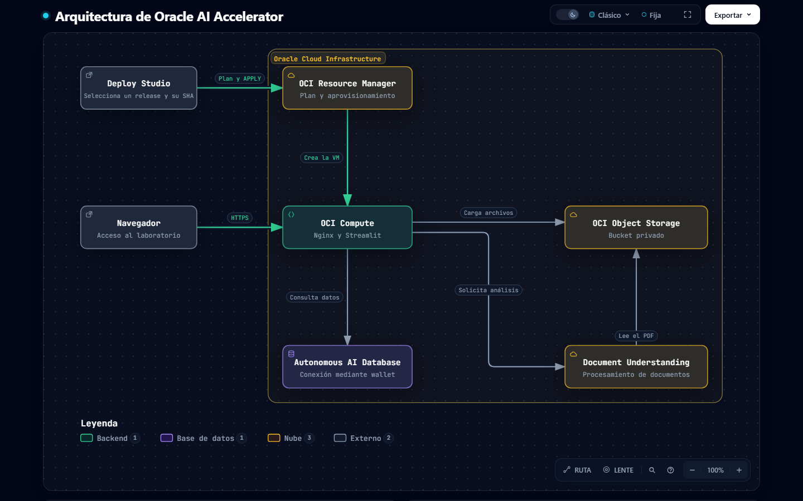

# Arquitectura de Oracle AI Accelerator

Oracle AI Accelerator es un laboratorio de OCI para probar el procesamiento de documentos, audio y texto desde una aplicación Streamlit. La modalidad de Deploy Studio instala el laboratorio en una máquina virtual Linux, junto con las dependencias de almacenamiento y base de datos.

El diagrama separa el aprovisionamiento desde Deploy Studio del uso de la aplicación desde el navegador.

## Despliegue

1. El operador selecciona un release en Deploy Studio y valida el perfil OCI y el compartimento. **Deploy** autoriza el plan de Resource Manager y, si pasa, el inicio de APPLY.
2. Terraform aprovisiona la red, la VM, un bucket privado y Autonomous AI Database. La VM comprueba el SHA seleccionado, prepara el wallet de base de datos, instala la aplicación y arranca los servicios.
3. Terraform espera la marca de inicialización. La VM escribe esa marca después de comprobar que Streamlit responde por HTTPS. Deploy Studio muestra la URL de la aplicación y los artefactos que declare el contrato.

[Contrato de Terraform](../terraform/README.md) · [Inicialización de la VM](../terraform/templatefile/user_data.sh)

## Uso del laboratorio

| Componente | Responsabilidad |
| --- | --- |
| OCI Compute | Nginx recibe HTTPS y reenvía las solicitudes a Streamlit. Streamlit presenta los módulos y ejecuta las tareas solicitadas. |
| Autonomous AI Database | Guarda usuarios, permisos y registros de trabajo. La aplicación abre la conexión con el wallet. |
| OCI Object Storage | Guarda los archivos del laboratorio en el bucket privado. La VM obtiene el wallet directamente de Autonomous AI Database. |
| OCI AI Services | Document Understanding procesa documentos del bucket. Los demás módulos invocan servicios como OCI Speech o Generative AI según la tarea. |

En el flujo de documentos, Streamlit recibe un archivo, lo guarda en el bucket e inicia el análisis. Document Understanding lee el objeto y genera los archivos de salida. La interfaz muestra el resultado y sus detalles.

[Definiciones SQL del esquema](../setup/autonomous_database) · [Entrada de la aplicación](../app/app.py) · [Procesamiento de documentos](../app/services/oci_document_understanding.py)

## Límites del laboratorio

La configuración de despliegue asigna una IP pública a la VM y usa un certificado inicial autofirmado. Limita el acceso a redes autorizadas y usa un certificado de confianza antes de compartir el laboratorio. Trata como sensibles las credenciales, el wallet y el estado de Terraform. [Credenciales y artefactos](../terraform/README.md#credenciales-y-artefactos)
